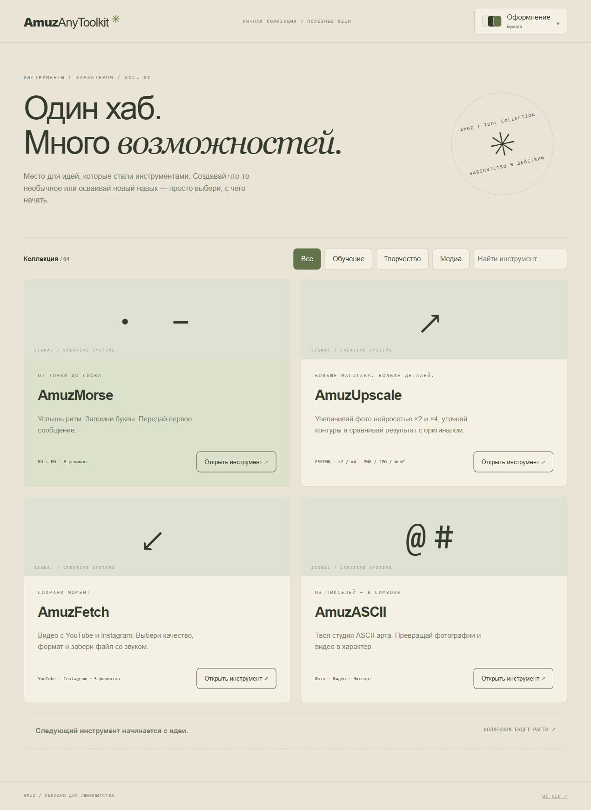
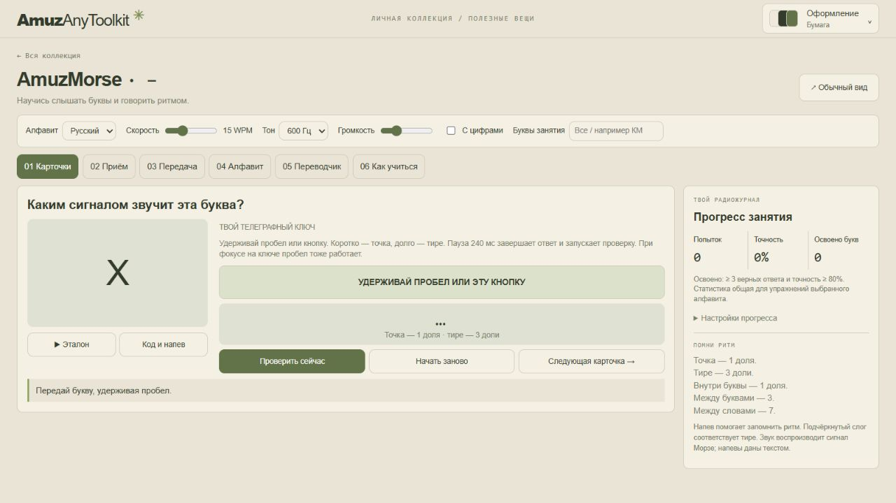
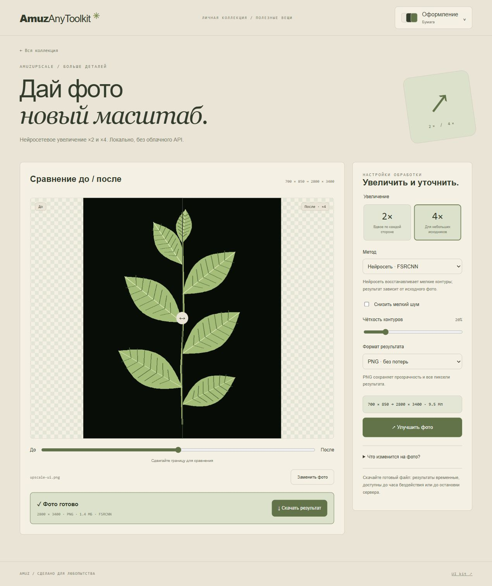
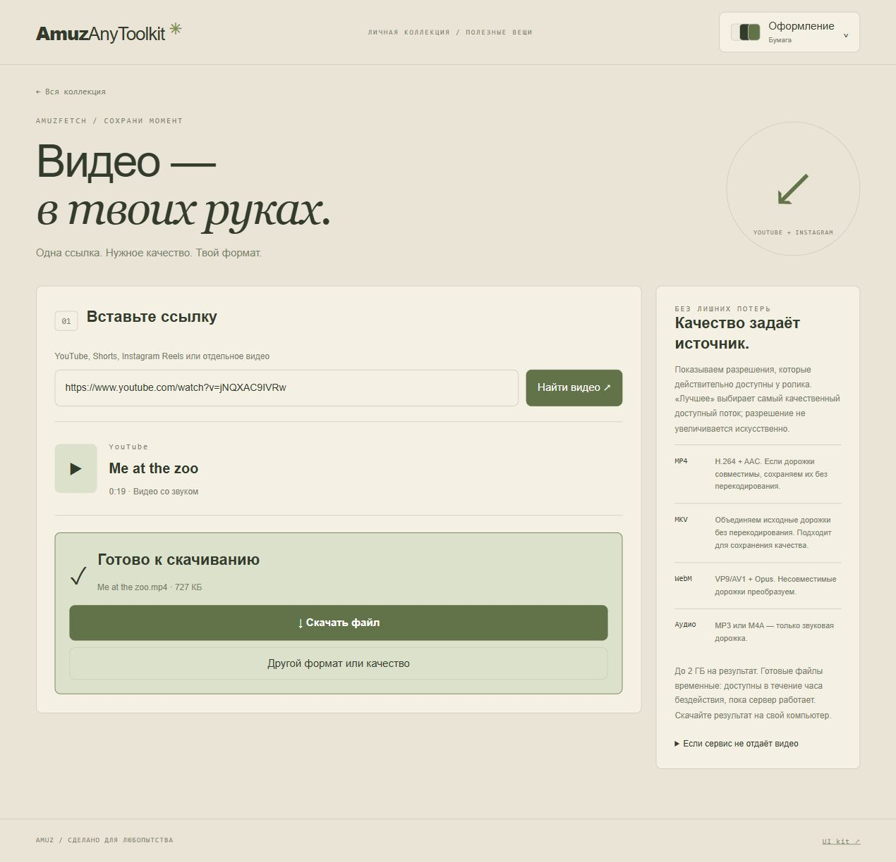
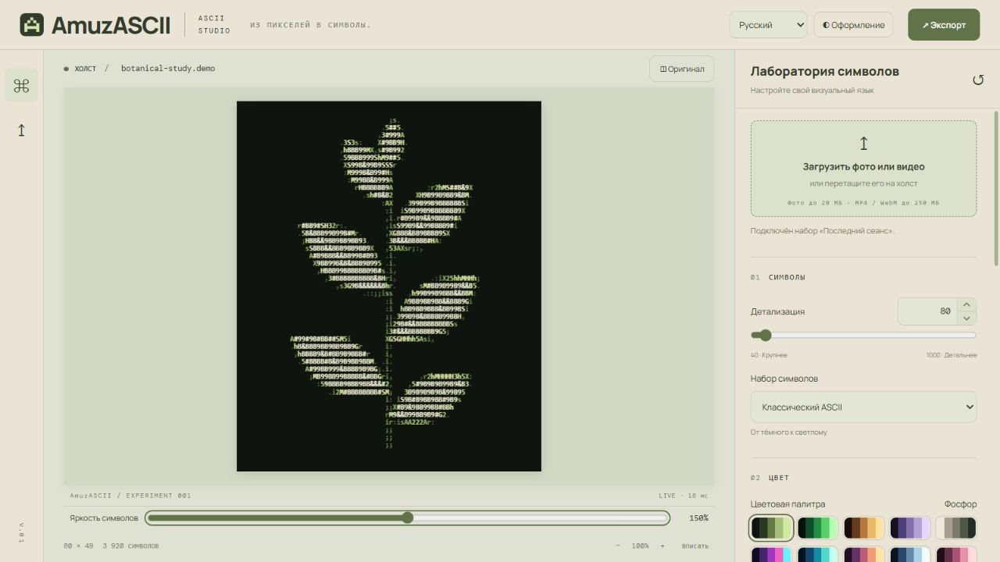
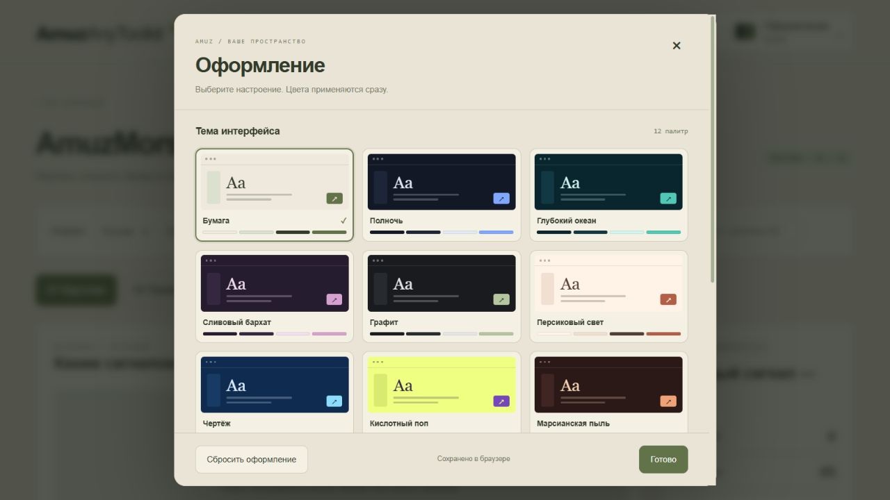

<div align="center">

# AmuzAnyToolkit

Организация: [AmuzAnyToolBox](https://github.com/AmuzAnyToolBox).

| Репозиторий | Назначение |
| --- | --- |
| [AmuzAnyToolkit](https://github.com/AmuzAnyToolBox/AmuzAnyToolkit) | Общий хаб со всеми инструментами |
| [AmuzASCII](https://github.com/AmuzAnyToolBox/AmuzASCII) | Фото и видео в ASCII-арт |
| [AmuzMorse](https://github.com/AmuzAnyToolBox/AmuzMorse) | Обучение азбуке Морзе |
| [AmuzFetch](https://github.com/AmuzAnyToolBox/AmuzFetch) | Загрузка видео |
| [AmuzUpscale](https://github.com/AmuzAnyToolBox/AmuzUpscale) | Увеличение фотографий |

Самостоятельные проекты формируются из этого общего исходника: `.venv/Scripts/python.exe scripts/export_projects.py ../AmuzAnyToolBox-projects`. Укажите новую, свободную папку для результатов. Скрипт включает общий UI kit и необходимые зависимости, создаёт точки входа и инструкции установки; существующие проекты не перезаписывает. Изменения между репозиториями автоматически не синхронизируются.

### Один хаб. Много возможностей.

Коллекция инструментов для творчества и обучения.<br>
**ASCII-студия · Азбука Морзе · YouTube / Instagram · Апскейлер фото · Общий UI kit**


[Возможности](#возможности) · [Установка](#установка) · [Запуск](#запуск) · [Морзе](#amuzmorse) · [UI kit](#ui-kit) · [Разработка](#разработка)

</div>



## Возможности

**Один репозиторий, один сервер, один адрес.** Хаб открывается на `/`, тренажёр Морзе — на `/#morse`, полная ASCII-студия — на `/ascii/`, загрузчик AmuzFetch — на `/#download`, апскейлер фото — на `/#upscale`. Для ASCII больше не нужен отдельный запущенный проект.

| Инструмент | Возможности |
| --- | --- |
| **Хаб** | Каталог, поиск, фильтры и быстрый переход к инструментам |
| **AmuzMorse** | RU/EN, цифры, карточки с телеграфным ключом, приём на слух, передача слов, русские напевы, переводчик и прогресс |
| **AmuzASCII** | Фото и видео → ASCII, палитры, коррекции, пресеты, экспорт изображений и полного видео |
| **AmuzUpscale** | Локальная нейросеть FSRCNN ×2/×4, шум/резкость, сравнение до/после, PNG/JPEG/WebP |
| **AmuzFetch** | YouTube и Instagram: выбор доступного разрешения, MP4/WebM/MKV, аудио MP3/M4A, прогресс и отмена |
| **UI kit** | 12 тем, общие палитры, компоненты, состояния, тонкие полосы прокрутки и интерактивная галерея |

## Установка

### 1. Подготовьте программы

Установите **Python 3.11 или новее**, **Node.js 22.12 или новее вместе с npm**. Git нужен только для клонирования: вместо него можно скачать репозиторий на GitHub через **Code → Download ZIP** и распаковать архив. Docker — отдельный вариант установки ниже, для него локальные Python и Node.js не требуются.

На Windows при установке Python включите **Add Python to PATH**. После установки программ перезапустите терминал и PyCharm, чтобы обновился PATH. Проверьте версии в PowerShell:

```powershell
python --version
node --version
npm.cmd --version
```

На Linux/macOS используйте `python3 --version`, `node --version`, `npm --version`. В Linux для создания окружения может потребоваться системный пакет `python3-venv`.

### 2. Получите исходники

Скачайте и распакуйте ZIP либо склонируйте репозиторий. В примере замените `АДРЕС_РЕПОЗИТОРИЯ` на HTTPS-адрес из **Code → HTTPS** на GitHub:

```powershell
git clone "АДРЕС_РЕПОЗИТОРИЯ" AmuzAnyToolkit
cd AmuzAnyToolkit
```

Все последующие команды выполняются **из корня AmuzAnyToolkit**, где находятся `run.py`, `server.py`, `requirements.txt` и `package.json`. При установке из ZIP откройте терминал в распакованной папке с этими файлами. Если проект уже есть на диске, повторно клонировать его не нужно.

### 3. Установите зависимости и соберите интерфейс

**Windows / PowerShell:**

```powershell
python -m venv .venv
.\.venv\Scripts\python.exe -m pip install --upgrade pip
.\.venv\Scripts\python.exe -m pip install -r requirements.txt
npm.cmd --prefix tools/ascii/frontend ci
npm.cmd run build
```

**Linux / macOS:**

```bash
python3 -m venv .venv
.venv/bin/python -m pip install --upgrade pip
.venv/bin/python -m pip install -r requirements.txt
npm --prefix tools/ascii/frontend ci
npm run build
```

`requirements.txt` устанавливает Python-зависимости всех инструментов, включая FastAPI, Pillow, PyAV, yt-dlp и imageio-ffmpeg. Последний предоставляет готовый FFmpeg для объединения и преобразования дорожек; отдельная установка FFmpeg обычно не требуется. Можно указать собственный бинарник через переменную `IMAGEIO_FFMPEG_EXE`. `npm ... ci` устанавливает Vue/Vite по lock-файлу; `npm run build` создаёт `tools/ascii/frontend/dist`. Общий UI kit берётся из этого же репозитория. Сам хаб и Морзе не требуют отдельной сборки или дополнительных пакетов npm в корне.

Окружение `.venv` активировать не обязательно: команды явно используют его интерпретатор. Сборка и виртуальное окружение не хранятся в Git, поэтому на новом компьютере эти шаги обязательны.

## Запуск

**Windows / PowerShell:**

```powershell
.\.venv\Scripts\python.exe run.py
```

**Linux / macOS:**

```bash
.venv/bin/python run.py
```

Откройте **http://127.0.0.1:8010**. Сервер обслуживает хаб, Морзе, ASCII и UI kit. Если `run.py` запущен другим Python, он автоматически перезапускается через интерпретатор `.venv` этого проекта, когда окружение существует. Устанавливайте зависимости в `.venv`. Остановка — Ctrl+C. Для другого порта добавьте `--port 8020`, для автоперезапуска Python при разработке — `--reload`. После изменения Vue или общих стилей ASCII заново выполните `npm run build`.

### Настройка PyCharm

1. **File → Open**: выберите корневую папку `AmuzAnyToolkit`, а не `tools/ascii` и не соседний старый проект.
2. В **Settings → Project → Python Interpreter → Add Interpreter → Existing** укажите `.venv/Scripts/python.exe` на Windows или `.venv/bin/python` на Linux/macOS.
3. Убедитесь, что зависимости установлены именно этим интерпретатором по командам выше. После выбора окружения дождитесь индексации PyCharm.
4. Запустите корневой `run.py` или конфигурацию **AmuzAnyToolkit**. Готовая конфигурация использует зарегистрированный интерпретатор проекта. Выберите `.venv` через Python Interpreter; одного пути в SDK_HOME недостаточно для регистрации SDK в PyCharm. При запуске другим Python скрипт автоматически использует `.venv`. Working directory — корень проекта. Добавлять `tools/ascii` в Sources Root или вручную изменять PYTHONPATH не требуется: backend использует пакетные импорты `tools.ascii.backend`.

### Если установка или запуск не удались

| Сообщение / проблема | Решение |
| --- | --- |
| `No module named uvicorn`, `fastapi`, `av`, `PIL` или `yt_dlp` | Выполните установку `-r requirements.txt` интерпретатором `.venv` и выберите этот же интерпретатор в PyCharm. Не устанавливайте зависимости в другой Python. |
| `No module named tools` или `server` | Запускайте корневой `run.py` как показано выше. Для `python -m uvicorn server:app` терминал должен находиться в корне проекта. |
| PyCharm подчёркивает внутренние импорты | Откройте корень монорепозитория и проверьте интерпретатор `.venv`; папки `tools` и `tools/ascii` уже содержат `__init__.py`. |
| PowerShell запрещает запуск `npm.ps1` | Используйте `npm.cmd`, как в инструкции. |
| `Cannot find package`, `vite` не найден или не поддерживается Node.js | Проверьте версию Node.js и выполните `npm.cmd --prefix tools/ascii/frontend ci`. |
| ASCII показывает предложение собрать интерфейс | Выполните `npm.cmd run build` из корня и перезапустите Python-сервер. |
| `Address already in use` / порт занят | Запустите `run.py --port 8020` и откройте адрес с этим портом. |
| Страница открыта как `file:///...` и модули не загружаются | Запустите сервер и открывайте HTTP-адрес, а не `index.html` с диска. |

### Docker Compose

```bash
docker compose up --build -d
```

Откройте **http://127.0.0.1:8010**. Docker сам устанавливает зависимости и собирает Vue. Для другого порта скопируйте `.env.example` в `.env` и измените `AMUZ_PORT`. Видеофайлы находятся в Docker volume `video-data`.

```bash
docker compose logs -f web
docker compose down
```

## AmuzMorse



### Компактный вид

Морзе по умолчанию открывается в компактном виде: настройки и режимы находятся сверху, буква и телеграфный ключ — рядом, прогресс и памятка — в боковой панели. Основные кнопки карточек, приёма и передачи помещаются на экране ноутбука 1280×720 при стандартном размере текста. На телефоне блоки перестраиваются по ширине экрана. Кнопка «Обычный вид / Компактный вид» рядом с заголовком переключает компоновку без сброса задания; выбор сохраняется в браузере под `amuz.morse.compact`. Это отдельная настройка от темы и плотности интерфейса.

### Карточки с телеграфным ключом

На карточке показана буква. **Нажмите и удерживайте пробел**, как рычаг телеграфного аппарата: короткое нажатие — точка, длинное — тире. Во время удержания звучит тон, ключ визуально нажимается. После паузы в три доли ответ проверяется автоматически; также есть кнопка «Проверить сейчас». Результат записывается в статистику один раз за попытку. «Начать заново» позволяет повторить букву.

Экранный ключ работает мышью и касанием. Клавиатурный ввод активен вне полей и других кнопок либо при фокусе на самом ключе. Ввод в текстовые поля не перехватывается. Показ ответа учитывается как попытка с подсказкой.

### Остальные режимы

- **Приём** — распознавание случайных букв и слов на слух, повтор сигнала и проверка ответа.
- **Передача** — буквы и слова через пробел или экранный ключ, отдельные кнопки точки/тире и разделения слов.
- **Алфавит** — коды, прослушивание и русские напевы из предоставленной таблицы. Подчёркнутый слог означает тире.
- **Переводчик** — текст ↔ Морзе и воспроизведение сигнала.
- **Как учиться** — последовательность занятий и правила ритма.

Ограничьте набор в поле «Буквы занятия»: например, `КМ` для русского или `KM` для английского. Пустое поле включает весь алфавит. Ошибочные буквы чаще появляются в карточках. Скорость: 5–40 WPM; длительность точки `1200 / WPM` мс, тире — три точки. Порог распознавания тире — две доли. Интервалы: 1 внутри буквы, 3 между буквами, 7 между словами; в передаче пробел между словами вводится отдельной кнопкой.

Русский и английский алфавиты поддерживают цифры. `Ё` соответствует `Е`, `Ъ` — `Ь`. Неизвестные символы переводчик обозначает `?`. Напевы текстовые; звук — синтезированный сигнал, без голосовых записей. Для английских букв показаны напевы соответствующих русских букв.

Прогресс и настройки сохраняются в браузере. RU/EN имеют отдельную статистику. Освоенная буква: не менее трёх верных ответов и точность ≥80%. Смена адреса, порта или браузера создаёт другое хранилище; синхронизации с аккаунтом нет.

## AmuzUpscale — улучшение и увеличение фото



Откройте **http://127.0.0.1:8010/#upscale** или карточку AmuzUpscale в хабе.

1. Загрузите JPEG, PNG или WebP через **«Выбрать фото»** либо перетащите файл в рабочую область. Кнопка **«Попробовать демо»** загружает демонстрационное изображение из проекта.
2. Выберите **×2** или **×4**. Это увеличение каждой стороны: количество пикселей растёт соответственно в 4 или 16 раз.
3. Выберите метод: **FSRCNN** для нейросетевой обработки на CPU или **Lanczos** для быстрого обычного увеличения. При необходимости включите мягкое снижение мелкого шума и настройте чёткость контуров.
4. Выберите PNG, JPEG или WebP и нажмите **«Улучшить фото»**. Сдвигайте границу сравнения «до/после», затем скачайте результат.

### Установка и запуск

Новая зависимость — `opencv-contrib-python-headless`. На существующей установке остановите сервер и обновите окружение:

```powershell
.venv\Scripts\python.exe -m pip install -r requirements.txt
.venv\Scripts\python.exe run.py
```

На Linux/macOS используйте `.venv/bin/python`. В подготовленном окружении текущего проекта пакет уже установлен. Для Docker выполните `docker compose up --build -d`.

Модели FSRCNN ×2 и ×4 уже включены в `tools/upscaler/models` вместе с исходной лицензией Apache-2.0; дополнительное скачивание весов, облачный API или GPU не нужны. Изображения обрабатываются на том компьютере, где запущен сервер. Приложение не отправляет фотографии сторонним AI-сервисам. Используется [OpenCV dnn_superres](https://docs.opencv.org/4.x/d5/d29/tutorial_dnn_superres_upscale_image_single.html) и [предобученные модели Saafke](https://github.com/Saafke/FSRCNN_Tensorflow); сведения о происхождении и контрольные суммы находятся в каталоге моделей.

### Форматы и ограничения

- Исходник: до **20 МБ**, **12 Мп**; результат: до **64 Мп**. Для слишком большого результата выберите ×2 или уменьшите исходное фото. Изображение не обрезается и не уменьшается незаметно.
- PNG сохраняется без потерь; JPEG — качество 95% и цветовая дискретизация 4:4:4; WebP — качество 95%. PNG/WebP сохраняют прозрачность, JPEG заменяет её белым фоном.
- Учитываются ориентация EXIF и встроенный цветовой профиль; результат — 8-битный sRGB. EXIF/GPS в экспорт не копируются. Анимированные изображения не поддерживаются.
- На CPU обрабатывается одно фото одновременно; допускается ещё одно в очереди. Прогресс отражает обработку изображения, а этап сохранения может занимать дополнительное время. Доступна отмена.
- Результаты и превью временные: до часа бездействия или до остановки сервера. После перезагрузки страницы восстанавливаются последнее задание и ссылка на готовый файл; для новой обработки выберите исходное фото заново.

В режиме **«Сравнить»** тяните круглый разделитель прямо на фото мышью или пальцем. Дублирующей шкалы под фото нет. Для просмотра целого изображения используйте кнопки **«До» / «После»**: каждая показывает целое фото с одинаковым масштабом и положением. «Вписать» показывает лёгкое превью до 1400 px по длинной стороне. Режимы **100% и 200%** загружают полное разрешение; увеличенное фото можно перемещать перетаскиванием или прокруткой. Чёткость контуров по умолчанию — 55%; радиус обработки учитывает масштаб ×2/×4. Скачиваемый результат сохраняет полное выбранное разрешение.

FSRCNN — компактная нейросеть для увеличения разрешения. Она может улучшить мелкие контуры, но не восстанавливает достоверно утраченные детали и не исправляет любой смаз. Повышенная резкость может подчеркнуть шум или создать ореолы. На некоторых фото эффект умеренный, особенно при просмотре всей картинки в уменьшенном виде.

## AmuzFetch — скачивание видео



Откройте **http://127.0.0.1:8010/#download** или карточку AmuzFetch в хабе.

1. Вставьте HTTPS-ссылку на отдельный ролик YouTube, Shorts или Instagram Reels/видеопубликацию.
2. Нажмите **«Найти видео»**: появятся название, длительность и доступные разрешения.
3. Выберите **формат** и **качество**. «Лучшее доступное» выбирает наибольшую доступную высоту кадра; увеличение разрешения не применяется.
4. Нажмите **«Подготовить файл»**, дождитесь загрузки и объединения дорожек, затем **«Скачать файл»**. Для следующего формата можно повторно получить сведения о том же видео.

| Формат | Обработка |
| --- | --- |
| MP4 | H.264 + AAC для совместимости. Совместимые дорожки копируются; другие преобразуются с CRF 18 / AAC 256 кбит/с. |
| MKV | Исходные кодеки копируются без перекодирования; лучший вариант для сохранения исходного качества. |
| WebM | VP8/VP9/AV1 и Opus/Vorbis копируются; другие кодеки преобразуются в VP9 / Opus. |
| MP3 | Только звук, VBR высокого качества. |
| M4A | Только звук, AAC 256 кбит/с. |

**Установка на существующем проекте:** остановите сервер, выполните `.venv\Scripts\python.exe -m pip install -r requirements.txt` из корня и запустите `run.py` снова. На Linux/macOS используйте `.venv/bin/python`. В текущем подготовленном окружении FFmpeg уже установлен вместе с Python-пакетом.

До двух активных задач. Лимит исходных дорожек суммарно и результата — **2 ГБ**. Обрабатывается полное видео, без намеренной обрезки. Файлы сохраняются временно на сервере, удаляются при остановке сервера или при следующем обращении после часа бездействия. После завершения скачайте результат на свой диск. Перезагрузка страницы восстанавливает последнее задание в том же браузере, пока оно доступно на сервере; серверная загрузка продолжается после закрытия вкладки. В Docker используется каталог `/data`.

Поддерживаются доступные без входа отдельные видеоролики. Instagram может требовать авторизацию, а YouTube — дополнительную проверку доступа. Для закрытых, удалённых, регионально недоступных роликов, прямых эфиров, подборок и DRM загрузка не гарантируется. Логины, пароли и cookies приложение не запрашивает. Доступны только прямые HTTP(S)-дорожки, выданные yt-dlp; потоковые манифесты HLS/DASH не загружаются. Если ролик не отдаётся, проверьте VPN и обновите экстрактор:

```powershell
.venv\Scripts\python.exe -m pip install --upgrade "yt-dlp[default]"
```

После обновления перезапустите сервер. Точность выбора потоков и параметры yt-dlp описаны в [официальной документации](https://github.com/yt-dlp/yt-dlp#format-selection).

## AmuzASCII

Полный исходный код студии находится в [`tools/ascii`](tools/ascii). Сохраняются обработка фото в браузере, серверная обработка видео, импорт, палитры, пресеты, персонализация и экспорт. Фотографии не отправляются на сервер при настройке предпросмотра; видео и импорт по ссылкам обрабатываются сервером. Видеофайлы хранятся временно.



Форматы изображений: PNG, JPEG, WebP, SVG, TXT, HTML. Видео: MP4, WebM, GIF. Для импорта YouTube используется yt-dlp и Node.js. Подробнее о студии — в [руководстве](tools/ascii/docs/guide.md). В едином приложении нажмите логотип AmuzASCII, чтобы вернуться в хаб.

## UI kit



Галерея: **http://127.0.0.1:8010/ui-kit/**. Исходники и документация — [`ui-kit/README.md`](ui-kit/README.md).

Общие темы: Бумага, Полночь, Глубокий океан, Сливовый бархат, Графит, Персиковый свет, Чертёж, Кислотный поп, Марсианская пыль, Неоновый город, Неоновый контур и Cyberpunk. Хаб, Морзе и ASCII используют одни определения палитр и прокрутки. Выбор оформления хранится для хаба и ASCII независимо. В хабе и Морзе кнопка **«Оформление»** открывает карточки всех 12 тем с цветными мини-превью и палитрами. В этой же панели доступны акцентный цвет, плотность интерфейса, размер текста, скругление и ширина панели Морзе. Все изменения применяются сразу и сохраняются в браузере; есть сброс к исходному виду.

```html
<link rel="stylesheet" href="/ui-kit/components.css">
<section class="amuz-panel">
  <div class="amuz-label">МОЙ ИНСТРУМЕНТ</div>
  <button class="amuz-button primary">Начать</button>
</section>
```

## Разработка

```text
AmuzAnyToolkit/
├── run.py                  # единая точка запуска
├── server.py               # FastAPI, API и маршруты всех инструментов
├── frontend/               # хаб + Морзе, HTML/CSS/ES-модули
│   ├── tools.js            # реестр инструментов
│   ├── morse.js            # алфавиты, кодирование и тайминги
│   └── app.js              # интерфейс, ключ, звук и прогресс
├── tools/ascii/            # полный Vue/FastAPI редактор
├── tools/downloader/       # AmuzFetch: API, загрузка и FFmpeg
├── tools/upscaler/         # AmuzUpscale: нейросеть, модели и экспорт
├── ui-kit/                 # общая дизайн-система
├── tests/                  # Морзе, импорты и интеграция единого сервера
├── requirements.txt
├── package.json
├── Dockerfile
└── compose.yaml
```

ASCII API остаётся на `/api/*`. Vue собирается с базовым путём `/ascii/`, его ассеты и worker обслуживает тот же сервер. Фото/видео-логика сохранена в `tools/ascii/backend`. Сборка и зависимости не включаются в Git. Дополнительного Git submodule нет: весь код обычными файлами лежит в одном репозитории.

### Добавить инструмент

Добавьте объект в `frontend/tools.js` с полями `id`, `name`, `category`, `tag`, `description`, `url`, `symbol`, `meta`. Для встроенного приложения используйте относительный URL и зарегистрируйте серверный маршрут до завершающего статического маршрута `/` в `server.py`. Новый режим внутри текущего интерфейса добавляйте в `route()` в `frontend/app.js`. Для новой категории добавьте кнопку фильтра в `home()`.

### Проверки

```powershell
.venv\Scripts\python.exe -m pip install -r requirements-dev.txt
npm.cmd test
npm.cmd run build
.venv\Scripts\python.exe -m pytest tests tools/ascii/backend -q
```

`npm test` запускает проверки Морзе и фронтенда ASCII. Для запуска Python-тестов установите `requirements-dev.txt` в то же окружение `.venv`; они используют pytest и httpx. `python -m pytest` из корня также запускает полный набор благодаря `pytest.ini`. Интеграционные тесты проверяют хаб, API, UI kit, все 5 форматов AmuzFetch на настоящих видеофикстурах, нейросетевой апскейл ×2/×4 и прозрачность, отмену, ASCII и его ассеты на одном сервере; сначала нужна production-сборка. Для разработки Vue: `npm.cmd --prefix tools/ascii/frontend run dev`, адрес `http://127.0.0.1:5173/ascii/`; `/api` проксируется на сервер `:8010`.

### Репозиторий

Это локальный Git-репозиторий, готовый к загрузке на GitHub. Удалённый адрес не зашит в конфигурацию. Корневой README является основной инструкцией запуска; внутренние заметки студии могут описывать отдельные функции AmuzASCII.
